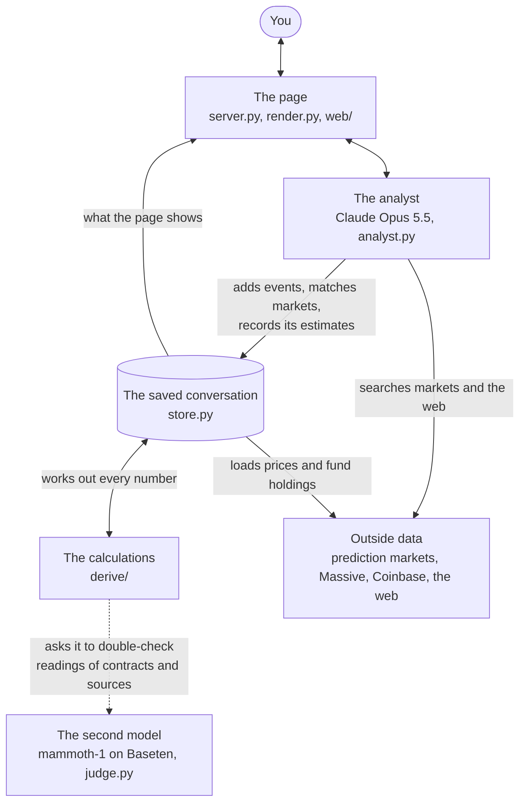
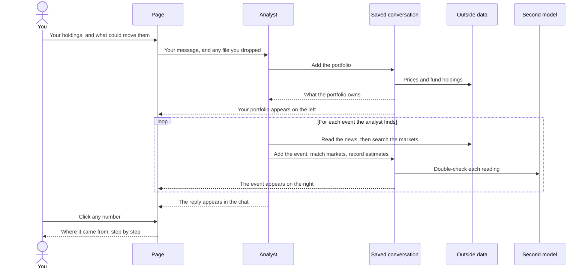
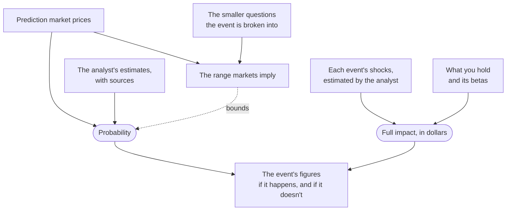

# event-risk

event-risk tells you what could move a portfolio. You give it your holdings and chat with an AI analyst
(Claude Opus 5.5). The analyst finds the geopolitical and macro events that matter to those holdings, puts a
probability on each one using prediction markets, and estimates how much the portfolio would gain or lose if each
one happens.

Beside the chat, a list of events (the ledger) shows each event with its numbers. You can click any number to see
where it came from: a market price, a calculation, or an estimate the analyst made, with its source.

| You ask | Where the answer comes from |
|---|---|
| What could move this portfolio? | The analyst, looking at what you own, the companies inside your funds included, at each company's news and filings, and at the news of the world |
| How likely is each event? | Prediction markets on Polymarket, Kalshi, and Hyperliquid: a market that asks the event, or markets on narrower, broader, or related questions, carried to it by the analyst's stated conditional probabilities; where no market bears on it, the analyst's estimate, built from smaller claims, each with its source |
| How much would it gain or lose? | The analyst's estimate of each event's shock to prices, applied to what you hold, less what is already priced in |

**On this page**

- [Quickstart](#quickstart)
- [Use the page](#use-the-page)
- [Read an event](#read-an-event)
- [How it works](#how-it-works)
- [Tour the repository](#tour-the-repository)
- [Saved conversations](#saved-conversations)
- [Keys and limits](#keys-and-limits)
- [Run the tests](#run-the-tests)
- [Troubleshooting](#troubleshooting)
- [Learn more](#learn-more)

## Quickstart

### Set it up with a coding agent

Paste this into Claude Code, Codex, or the coding agent you use:

```
Clone https://github.com/owassmer/event-risk, install it with uv, put my Anthropic, Massive and Baseten keys in .env
(ask me for them), and start it with `uv run event-risk`. Follow the README if anything fails.
```

To set it up yourself, follow the steps below.

### Before you begin

You need:

- [uv](https://docs.astral.sh/uv/), which installs and runs the project. If your machine doesn't have Python
  3.12 or later, uv fetches it.
- Three API keys. To see what each key does, see [Keys and limits](#keys-and-limits).
  - **Anthropic**, from the [Claude Console](https://platform.claude.com/). The account needs access to Claude
    Opus 5.5.
  - **Baseten**, from [Baseten](https://www.baseten.co/), for the second model (mammoth-1, through Baseten's
    System One API). Without it, the page still works: new readings just go unchecked.
  - **Massive**, from [Massive](https://massive.com/), for prices, fund holdings, and companies' news and filings.

### Install

```
git clone https://github.com/owassmer/event-risk
cd event-risk
uv sync
```

### See a finished example

```
uv run example
```

The page opens on a finished conversation about a six-holding portfolio (NU, TSM, XOM, DAL, RTX, and EEM): the
ten events the analyst found, their probabilities, and what each would do, every number one click from where it
came from. You don't need any keys, and nothing is fetched. The example is read only; to start your own, add your
keys and start the page.

### Add your keys

Create a file named `.env` at the top of the repository:

```
ANTHROPIC_API_KEY=...   # Claude: the analyst, its web search, and its reading of web pages
BASETEN_API_KEY=...     # Baseten: the second model, which double-checks the analyst
MASSIVE_API_KEY=...     # Massive: stock and fund prices, what each fund holds, and companies' news and filings
```

Git ignores `.env`, so your keys stay on your machine.

### Start the page

```
uv run event-risk
```

The page opens in your browser at `http://127.0.0.1:8765/`, ready for a new conversation.

### Open a saved conversation

Every conversation is saved in its own folder under `stores/`. To open one:

```
uv run event-risk --store stores/<name>
```

The page opens with that conversation and its events. You don't need any keys to read it.

## Use the page

The page has three parts. The chat is in the middle. Your portfolio appears on the left once the analyst has priced
it, and the list of events appears on the right once the analyst adds the first one.

```
┌────────────────┬────────────────────────────────┬────────────────────┐
│ Portfolio      │ The chat                       │ Events             │
│                │                                │                    │
│ total value    │ your messages                  │ one line per event,│
│ holdings       │ the analyst's replies          │ ranked             │
│ look-through   │ a status line while it works   │                    │
│ exposure       │                                │ details open here: │
│ factor         │                                │ an event, a number,│
│ exposures      │ [ Message the analyst      ↑ ] │ a holding, a factor│
└────────────────┴────────────────────────────────┴────────────────────┘
```

On a narrow window, the side panels become **Portfolio** and **Events** buttons at the top. The page uses your
system's light or dark setting.

### 1. Give the analyst your holdings

Type or paste your holdings, one per line. Give each as dollars, a percentage, or a number of shares, and include
cash. For example:

```
SPY 50%
AAPL 20%
TLT 20%
Cash 10%
$50,000 total. What could move this?
```

Instead of typing, you can drop in a broker statement (PDF), a spreadsheet export (CSV), or a screenshot. The
analyst reads it.

### 2. Watch your portfolio being priced

While the page prices your portfolio, a status line in the chat says what it's doing: pricing your holdings,
looking inside your funds, loading two years of prices, and fitting your holdings' betas. The left panel fills in
as each part is ready:

- **Total value**, its day change, and when the prices are from.
- **Holdings**, as you gave them, each with its value, weight, and day change. Click one to open it like a
  broker's position page: its price history, your position, what the company does or what the fund holds (by
  name, listing country, and asset class), its betas, and the events that move it most.
- **Look-through exposure.** Your largest names once your funds are looked through. A stock you own directly and
  through a fund shows both amounts and the total.
- **Factor exposures.** A new portfolio starts with one factor, the S&P 500: your dollar beta to it, your beta,
  and its largest one-month move in the last two years applied to the dollar beta. The analyst adds a factor for
  each other force an event moves your portfolio through, such as rates, oil, a region, or a sector.

Every dollar figure on the page is exact to the cent, and the parts shown together add to the whole. While the
prices are today's, they update every minute, with the prediction markets, and every figure on the page updates
with them. A holding you gave in dollars or as a weight keeps the number of shares it had then, so its value moves
with its price.

This takes about half a minute.

### 3. Watch the analyst work

The analyst reads the news, your companies' own news and filings, and the pages it finds, decides which events
matter to your holdings, then searches the prediction markets and builds each event. While it works, one
status line shows what it's doing right now and how many steps it has taken. Click the line to see its reasoning
and each step, with what it sent and what came back.

Each event appears on the right as soon as the analyst adds it, and its numbers fill in as they're worked out. The
analyst's full first answer takes a few minutes.

### 4. Read the events and open anything

Each line on the right is one event. To learn how to read one, see [Read an event](#read-an-event).

You can click almost anything, and its details open on the right:

- an event;
- any number;
- a holding or a name in your portfolio;
- a highlighted name in the analyst's reply or one of its notes. When the analyst mentions an event, a market, a
  stock, a factor, a page it read, one of its notes, an event's shock to a price, a calculation, or one of the
  second model's checks, it appears as a small labelled box showing its current value or figure.

What you open from inside the panel is added to a breadcrumb trail at its top, and what you open from the
portfolio or the conversation starts a new trail. **Back** goes back one step, to where you were, and **Events**
at the start of the trail returns to the list.

### 5. Keep talking

- **Ask follow-up questions.** For example, ask which event matters most for your largest holding. The analyst
  answers from what it has already built.
- **Send a message while the analyst is working.** It waits, then goes when the current reply ends.
- **Stop** ends the analyst's current reply where it is. Everything it built so far stays.
- **Edit** one of your messages, or **Retry** one of the analyst's replies. The conversation goes back to just
  before that message, along with everything the analyst built after it, and a new reply starts from there. An
  edited message keeps the files you sent with it, and you can remove any of them before sending.

### 6. Save the results

Open the menu (⋯) in the top right corner:

- **Download ledger** saves a readable document with your portfolio and every event.
- **New portfolio** starts a new conversation.
- **Open conversation…** opens an earlier one.

## Read an event

The list looks over one horizon, 180 days from the date of its prices. Each line shows an event, the figure the
list is ranked by, the event's probability with the range markets imply and its last month, and what it would do
to your portfolio on Yes and on No.

The list is ranked by **Expected move**: how much the event is expected to move your portfolio when it resolves,
either way. Switch to **Worst case** to rank by the largest possible loss.

Click an event to open it. It starts with when it can happen and how it would be known, with its full definition
a click away, then its figures. For example:

| | |
|---|---|
| **Probability** | 19%, markets imply 10%–33% |
| **Yes** | −$2,828.95, −2.83% of portfolio |
| **No** | +$659.70 |
| **Full impact** | −$3,488.65 |
| **Expected move** | ±$1,069.91 |
| **Largest contributors** | NVDA, AAPL, MSFT, through QQQ |

| Figure | What it is |
|---|---|
| Probability | How likely the event is, by the horizon's end or on its own date. The range is what the prediction markets imply: a floor, a ceiling, or both. "Our estimate" means the analyst states it and no market prices it; "derived" means it is worked out from other questions, whose markets or estimates the event shows. |
| Yes | Your portfolio's gain or loss if the event happens: the part not already priced in. |
| No | The move the other way if it doesn't happen, since some of it was priced in. |
| Full impact | The difference between the two outcomes. |
| Expected move | How much the event is expected to move your portfolio when it resolves, either way: each outcome weighed by its probability. |
| Largest contributors | The names that contribute most, including the stocks inside your funds. |

Below the figures, the event shows:

- **By holding.** Each holding the event moves, on Yes and on No, with a bar for its full impact: losses to the
  left, gains to the right.
- **Notes:** the analyst's note on the event, and any note that explains several parts of it.
- **Shocks.** For each price or measure the event would move: its shock, the difference between where it ends
  with the event and without it, with the analyst's source; and, for a price, today's level and where it ends if
  the event happens and if it doesn't. A shock to a measure given in percent, such as an interest rate, reads in
  percentage points.
- **Markets.** First the probability history: the price of the market that prices the event, over time, with
  today's implied range. Prediction markets rarely ask exactly the question you care about, so the analyst breaks
  the event into smaller questions and finds the markets that ask those. A tree shows the event, the smaller
  questions under it, and the markets under each.
  - Each market shows its price, bid, ask, and depth, and whether the second model reads it as asking that exact
    question; click that to see its two checks. A market that asks the opposite question counts at one minus its
    price.
  - Where the analyst works the probability out from other markets, the formula shows with its values, each input
    by letter, and each estimate the analyst made with its reason.
  - Markets the analyst read but didn't use stand apart, beside the analyst's reason, and the page counts the
    searches.

Click any number to see its working: the formula with its values filled in, each input labelled and opening one
step further. Every line of working reconciles to the cent.

## How it works

### The parts and how they fit



The system has four parts:

- **The analyst does the thinking.** It starts from what you own: each holding is a company and what it does, or
  a fund and what it holds. It decides which events matter to those holdings and defines each one. It breaks each
  event into smaller questions and decides which market asks which question. When a number can't be
  looked up, it makes the estimate itself and records the figures it rests on, with how they carry to it. It works through a fixed set
  of actions (`harness/tools.py`), such as searching a market or adding an event.
- **A second model double-checks the analyst's reading.** The code calls it the judge. It answers narrow
  questions: does this market really ask this question, and does this claim really follow from that one. It never
  supplies a forecast. When it doubts a reading, the analyst corrects
  it or explains why it stands. Its answers never hold anything up.
- **The calculations do all the arithmetic.** They read market prices, your holdings, and what your funds hold.
  From those they work out your betas and dollar betas, the range markets imply, each event's probability, and the
  dollars.
- **The saved conversation holds it all.** Each conversation is one database. The analyst records what it builds
  there, and the calculations work out every number from it when the page asks. Each number keeps a record of what
  produced it, and it's worked out again whenever anything it depends on changes.

### One conversation, step by step



### How an event's numbers are worked out



Here is each step in plain terms:

1. **What you own.** The page looks inside each fund, so a stock you own directly and through funds counts once,
   with all of its dollars, and the analyst sees each holding as what it is: a company and what it does, or a fund
   and what it holds, by name, listing country, and asset class. A new portfolio starts with one factor, the S&P
   500, and the page fits each holding's beta to it over two years of daily prices, a fund's on the fund's own
   prices. When an event moves your portfolio through something else, such as rates, oil, a region, or a sector, the
   analyst adds a factor for it, and every holding's betas are fitted again.
2. **Breaking an event into smaller questions.** An event is something that happens in the world; prices and
   yields are where its consequences show. The list looks over one horizon, 180 days: an event that could happen at
   any time is watched to the horizon's end, and one with a date of its own, such as a central bank's decision, on
   that date. Prediction markets rarely ask exactly that question, so the analyst breaks it into smaller questions
   that markets do ask. For example, take "the US raises tariffs on Mexican imports by March 31". A market on "the
   US raises tariffs on Mexican imports to 25% or more by March 31" can't resolve yes unless the event happens, so
   its price sets a floor. A market on "the US raises tariffs on one of its three largest trading partners by
   March 31" resolves yes whenever the event happens, so its price caps the probability. The second model checks
   that each market really asks the question it's matched to.
3. **From prices to a probability.** A market's price is the one its venue shows: usually the midpoint of the bid
   and the ask, or the last trade's price when those two are far apart. A price is what traders pay, and it can sit
   away from the probability: a thin book holds one trader's quote, a long-dated longshot carries the interest its
   money gives up until the close, and a feared outcome carries what hedgers pay to insure against it. The analyst
   decides whether to take a market's price as the probability; where it doesn't, the market is one of its sources.
   Logic turns the related markets into the range markets imply. Inside that range, the probability is one of three
   things:
   - the price of a market that asks the event exactly;
   - an estimate built on market prices, where the analyst states the one number the markets don't give. In the
     tariff example, that number is how likely a raise on one of the three partners includes Mexico.
   - the analyst's own estimate, when no market bears on the event: built from the smaller claims it breaks into,
     each narrower than the event and so easier to source, or stated whole. The range is then 0% to 100%, and the
     event says so.
4. **From shocks to dollars.** For each price or measure the event would move, the analyst states its shock, the
   difference between where it ends with the event and without it, with its source. The calculations carry each
   shock to what you hold through each holding's betas, a fund's fitted on the fund's own prices, and a shock to
   one company reaches its shares inside your funds as well as those you hold directly. Added up, that is the full
   impact.
5. **What's already priced in.** Today's prices already price in the event's probability. So if the event
   happens, your portfolio moves only by the part not yet priced in. If it doesn't happen, it moves back by the part
   that was. The list is ranked by the expected size of that move, its expected move. The worst-case ranking keeps
   an unlikely event with a large loss in view.

## Tour the repository

```
event-risk/
├── harness/                the system
│   ├── analyst.py          runs the analyst: Claude with its actions, streaming, Stop, edit, and retry
│   ├── claude.py           the settings every request to Claude uses
│   ├── tools.py            the actions the analyst can take
│   ├── schema.py           every kind of thing a saved conversation can hold, listed once
│   ├── store.py            the saved conversation's database: what the analyst built, the data behind it,
│   │                       and the snapshots that edit and retry go back to
│   ├── derive/             the calculations behind every number
│   ├── judge.py            the second model's checks
│   ├── world.py            searching the markets, the web, and companies' records, and reading pages
│   ├── web.py              web search and page reading through the Claude API
│   ├── venues/             connections to Polymarket, Kalshi, Hyperliquid, Massive, and Coinbase
│   ├── ledger.py           the event list's rows, and the gaps the analyst checks for
│   ├── render.py           draws the page's panels, the detail views, and the downloaded ledger
│   ├── server.py           the web server behind the page, and the event-risk and example commands
│   ├── trace.py            the conversation's record: every message, step, and result
│   ├── ontology.py         writes the analyst's guide to the saved conversation from schema.py
│   └── credentials.py      keeps API keys out of everything that's saved
├── knowledge/              what the analyst reads before it starts
│   ├── system.md           its instructions
│   ├── MATH.md             the formulas
│   ├── ONTOLOGY.md         what the calculations work out from each thing the analyst adds
│   ├── TOOLS.md            every action, with its exact inputs and outputs
│   ├── DATA.md             how to search the prediction markets and the web
│   └── channels.yaml       the one factor every new conversation starts with, the S&P 500
├── web/                    the page in the browser: HTML, JavaScript, styles, and fonts
├── tests/                  the test suite
├── example/                a finished conversation, which uv run example opens
└── stores/                 your saved conversations, one folder each, kept out of Git
```

To understand the system, read in this order:

1. `knowledge/MATH.md`: all of the mathematics.
2. `knowledge/ONTOLOGY.md`: what the calculations work out from each thing the analyst adds.
3. `knowledge/system.md`: the analyst's instructions.
4. `harness/tools.py`: every action the analyst can take.
5. `harness/derive/`: how each number is calculated.

## Saved conversations

Each conversation is saved in its own folder:

```
stores/<name>/
├── store.sqlite   the database: what the analyst built, the data it used, and every number worked out from it
├── trace.jsonl    the conversation's record: every message, step, and result, in order
└── files/         files dropped into the conversation
```

- A new conversation is saved when you send your first message. Its folder is named for the date of its prices,
  such as `stores/2026-11-05`, with `-2`, `-3`, and so on added when that name is taken.
- A saved conversation keeps all of the data it used, so it opens and explains every number without any keys.
- With the Anthropic key, you can keep chatting in a saved conversation you opened.
- Git ignores `stores/`, so your conversations stay on your machine.

## Keys and limits

| Key | What it's for | Without it |
|---|---|---|
| `ANTHROPIC_API_KEY` | The analyst, its web search, and its reading of web pages | The analyst can't reply. Saved conversations still open. |
| `BASETEN_API_KEY` | The second model, which double-checks the analyst | New readings go unchecked. Every number is still worked out. |
| `MASSIVE_API_KEY` | Stock and fund prices, what each fund holds, and companies' news and filings | A new portfolio can't be priced, and companies' news and filings can't be read. Saved conversations still open. |

Looking inside funds uses Massive's ETF Global data, which is a separate entitlement on a Massive account.
Without it, each fund counts as one holding, with its own betas. Crypto prices, such as bitcoin's, come from
Coinbase Exchange's public data and need no key.

A missing key shows as one line, only where it stops something. Without the Anthropic key, the message box says
the analyst can't reply. Without the Baseten or Massive key, a line in the message box says what goes without it.

Expect these times and limits:

- **Pricing a new portfolio** takes about half a minute.
- **The analyst's full first answer** takes a few minutes.
- **The list looks over 180 days.** Over that horizon, two years of price history and today's markets still
  describe the same world.

## Run the tests

```
uv run pytest -q
```

The tests don't need keys or a network connection. The markets, the web search, and the second model are
replaced with stand-ins.

## Troubleshooting

- **A line in the message box names a missing key.** Add the key to `.env` and start the page again.
- **The analyst can't search the web.** An administrator can turn web search off for an organization in the
  Claude Console, under Settings, then Capabilities. Turn it back on there.
- **"The analyst couldn't reply" appears.** The line includes the reason, such as an account usage limit. Send
  your message again once the cause is fixed.
- **The port is already in use.** Start on another port: `uv run event-risk --port 8777`.
- **You want to start the page without opening a browser.** Run `uv run event-risk --no-browser`.

## Learn more

`knowledge/` holds everything the analyst reads, and it is also the clearest description of the system:

- `MATH.md`: the mathematics;
- `ONTOLOGY.md`: what's calculated from what;
- `TOOLS.md`: every action the analyst can take, with its inputs and outputs;
- `DATA.md`: how the analyst searches the prediction markets and the web;
- `system.md`: the analyst's instructions.
