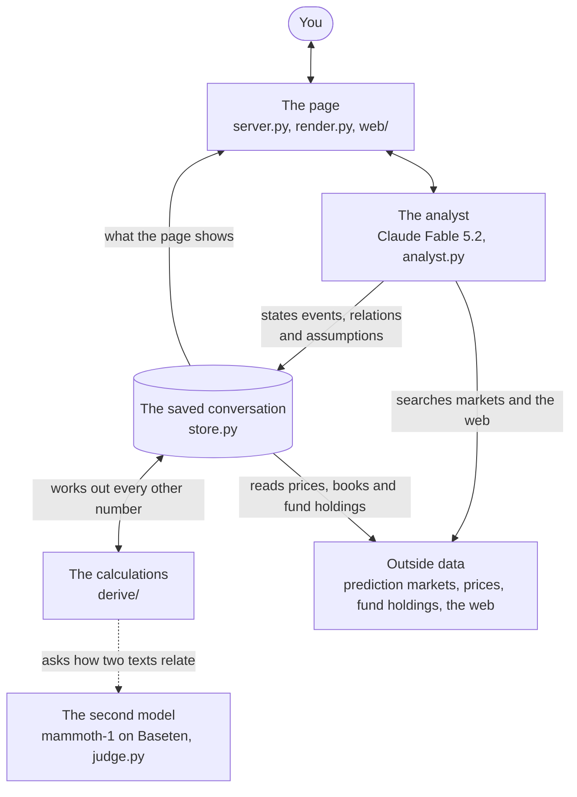

# event-risk

event-risk identifies events that could move your portfolio, estimates how likely they are, and calculates how much you could gain or lose under each outcome. The AI analyst (Claude Fable 5.2) starts with your holdings, including the companies you own through funds. It researches events that matter to those holdings and uses prediction markets where they provide evidence about an event's probability.

[Explore the example portfolio](https://owassmer.github.io/event-risk/) to see the 13 events the analyst found for a sample brokerage account. Open a forecast to see its market evidence and assumptions, select a gain or loss to see which holdings contribute, or replay the analysis from the first message.

| You ask | Where the answer comes from |
|---|---|
| What could move this portfolio? | The analyst reads company filings, news and other sources to identify events that could affect your holdings. |
| How likely is each event? | The analyst searches Kalshi, Polymarket and Polymarket US. When a market asks a related question, the analyst specifies whether one outcome implies the other or changes its probability. The system calculates the forecast from those relationships, market prices and the analyst's assumptions. If it finds no relevant market, it estimates the probability from other evidence. |
| How much could I gain or lose? | The analyst estimates how each outcome would move prices. The system applies those assumptions to your holdings and calculates the gain or loss relative to today's portfolio value, accounting for what prices already reflect. |

**On this page**

- [Quickstart](#quickstart)
- [Use the page](#use-the-page)
- [Read an event](#read-an-event)
- [How it works](#how-it-works)
- [Tour the repository](#tour-the-repository)
- [Saved conversations](#saved-conversations)
- [Keys and limits](#keys-and-limits)
- [Run the tests](#run-the-tests)
- [Troubleshooting](#troubleshooting)
- [Learn more](#learn-more)

## Quickstart

### Set it up with a coding agent

For a live analysis, give your coding agent these instructions.

```
Clone https://github.com/owassmer/event-risk and install it with uv. Help me set up .env for a live analysis
using Anthropic and Massive, plus Baseten if available. Then start the app with `uv run event-risk`.
```

### Before you begin

Install [uv](https://docs.astral.sh/uv/) to run the project locally. It can install Python 3.12 or later for you. The saved example runs without API keys.

A new analysis uses the following services.

- [Anthropic](https://platform.claude.com/) provides Claude Fable 5.2 for the analyst and Claude Haiku 5.5 for web searches and page reading. Your account needs access to both models.
- [Massive](https://massive.com/) provides prices, fund holdings, company news and filings. Coverage depends on your plan.
- [Baseten](https://www.baseten.co/) is optional. It runs a second model (mammoth-1) that checks the analyst's interpretation of market questions and related claims.

See [Keys and limits](#keys-and-limits) for the data included with each entitlement.

### Install

```
git clone https://github.com/owassmer/event-risk
cd event-risk
uv sync
```

### Open the example locally

```
uv run example
```

This opens a read-only copy of the same analysis as the web example. The sample brokerage statement lists about $504,000 across eight stocks, five funds and cash. All 13 events and their supporting data are included, so you can explore them offline after installation.

### Add your keys

For a live analysis, create a file named `.env` at the top of the repository. Include `BASETEN_API_KEY` if you want the second model to check the analyst's interpretations.

```
ANTHROPIC_API_KEY=...   # Analyst and web research
MASSIVE_API_KEY=...     # Prices, fund holdings, company news and filings
BASETEN_API_KEY=...     # Optional second model
```

Git ignores `.env`, so your keys stay on your machine.

### Start the page

```
uv run event-risk
```

Your browser opens a new conversation at `http://127.0.0.1:8765/`. To run the live app and the example at the same time, start one with `--port 8777`.

### Open a saved conversation

To reopen a conversation, pass its folder under `stores/` to the live app.

```
uv run event-risk --store stores/<name>
```

You can read a saved conversation and inspect its events without API keys.

## Use the page

A new conversation opens with **What could move your portfolio?** Enter your holdings or attach a statement to get started.

The top bar shows the portfolio value, daily change, volatility over the analysis horizon, and the time of the latest prices. Three views sit beside the analyst's conversation.

| View | What you can see |
|---|---|
| **Events** | Each event's forecast and its effect on the whole portfolio. Select an event to see its outcomes, probability and assumptions. |
| **By holding** | How much each holding would gain or lose if each event happened. |
| **Portfolio** | Your positions and exposures, including the companies you own through funds. |

On a wide screen, the event list stays beside the selected event. Figures, holdings, factors, markets and sources open in a detail panel. The **Analyst** button shows or hides the conversation, which opens over the main view on narrow screens. The page follows your system's light or dark setting.

### 1. Give the analyst your holdings

Type or paste one holding per line, including cash. You can use dollar amounts, percentages or share counts.

```
SPY 50%
AAPL 20%
TLT 20%
Cash 10%
$50,000 total. What could move this?
```

You can also attach a brokerage statement (PDF), a spreadsheet export (CSV) or a screenshot.

### 2. Watch your portfolio being priced

The analyst's progress line shows each stage as the system prices the holdings, identifies the companies inside funds, loads two years of prices, estimates betas and retrieves reports for your largest holdings. The page starts in **Portfolio** and switches to **Events** when the first event appears.

- The portfolio summary shows total value, daily change, number of positions and **horizon volatility**, the typical change in portfolio value over the period covered by the analysis.
- **Holdings** lists each position's weight, value and daily change.
- **Exposure** shows portfolio weight by company, industry or country. Select a company to see how much you hold directly and through each fund.
- **Factor exposures** shows your dollar beta to each factor and the portfolio impact implied by that factor's largest monthly move in the past two years. The S&P 500 is the starting factor. The analyst can add others, such as interest rates, oil or a sector. For a yield, the exposure is the dollar gain or loss per percentage-point increase.

For a portfolio priced as of today, the app refreshes prices and market quotes every minute. Positions entered as dollar amounts or weights keep their original share counts, so their values change with prices.

### 3. Watch the analyst work

The analyst reads reports from your largest holdings, searches company news and other sources, and checks prediction markets for evidence about the events it identifies. Open the progress line to inspect the steps, including each request and its result. Events appear as the analyst adds them, and their figures update as the calculations finish.

### 4. Inspect the evidence

Select an event in **Events**, a position or exposure in **Portfolio**, or a linked figure in the analyst's reply. Events open in the main area. Supporting details open in a panel with **Back** and **Close** controls.

- A **holding** shows its price history, your position, the company profile or fund holdings, its betas and the events with the largest impact.
- A **factor** shows two years of prices for its proxy, its largest monthly move, your dollar beta and each holding's contribution.
- A **market** shows the question, order book, closing time and settlement rules.
- An **outcome** breaks the portfolio gain or loss down by holding, including the companies held through funds.
- A **shock** compares the assumed price move with the historical periods the analyst used to estimate it. The same panel gives the reasoning and the price in each outcome.
- A **source** shows which figures cite it and the supporting passages, with a link to the full text.
- A **calculated figure** opens its inputs and, for totals, the contributions that add up to it. **Full details** shows the underlying values. The page displays prices to the cent and event gains and losses in whole dollars.

### 5. Keep talking

- Ask which event matters most for a particular holding.
- Ask how events combine. Each row describes one event in isolation. For a joint analysis, the analyst can estimate how the probability of one event changes if another occurs and show the portfolio gain or loss in each combination of outcomes.
- A message sent while the analyst is working is queued until the current reply ends.
- **Stop** ends the current reply and preserves the work completed so far.
- **Edit** a message or **Retry** a reply to restore the analysis to the point before that message and start a new reply.

### 6. Save the results

- **Download ledger** in the top bar saves a CSV file with one row per event, its figures, and each holding's gain or loss if the event happens.
- The menu at the top left starts a **New portfolio** or opens an earlier conversation (**Open conversation…**).

## Read an event

The **Events** header shows the end date of the analysis and the days remaining. Each row gives the event's own date, forecast, market range where available, and, under **P&L**, the portfolio's gain or loss **If Yes** and **If No**. The If Yes figure also appears as a share of portfolio value.

All rows use the same dollar scale, with **Today** at zero. The bar spans the modeled losses and gains, with ticks for individual outcomes when there are more than two. The gray band shows the portfolio's horizon volatility for comparison. Sort by **Volatility** or **Worst outcome**. Open **By holding** for the same events broken down by position.

Select an event to see its definition, how to determine whether it happened, and the analyst's rationale.

| Figure | What it is |
|---|---|
| **Forecast** | The estimated probability of the event. Open it to see the forecast and market range on a 0–100% scale, along with the markets and assumptions used to calculate it. |
| **Market range** | The lowest and highest probabilities consistent with the relevant bids and asks and the stated relationships between those markets and the event, before applying the analyst's probability estimates. |
| **Market** | When the event's own market midpoint differs from the forecast, the midpoint appears as a percentage, with the bid and ask in cents. |
| **If Yes** | The estimated portfolio gain or loss from today's value if the event happens. If several outcomes count as Yes, this is their probability-weighted average conditional on Yes. |
| **If No** | The corresponding gain or loss if the event does not happen. |
| **Full impact** | The difference between the If Yes and If No figures. |
| **Volatility** | The probability-weighted standard deviation of the portfolio gains and losses across this event's outcomes. |
| **Worst outcome** | The modeled outcome with the lowest portfolio gain or loss among those with positive probability. |
| **Expected value** | The probability-weighted average gain or loss across all outcomes, shown when nonzero. It can differ from zero when the forecast differs from the probability reflected in today's prices or when a holding is valued by its terms or its estimated payoff. |

Below the figures are three tabs.

**Outcomes** shows the portfolio effect of each outcome.

- **P&L by outcome** shows the gain or loss from today's value and the probability of each outcome, with the baseline marked. Switch to the event date to see the distribution of gains and losses within each outcome and across all outcomes combined.
- **Shocks** lists the price moves the analyst assumed.
- The outcome table gives probabilities, gains and losses, and the 5th and 95th percentiles on the event date. **Holding P&L** breaks the result down by position.
- **Largest contributors** shows which companies contribute most to the difference between Yes and No and whether you hold them directly, through funds, or both.

**Probability** shows how the forecast follows from market evidence and the analyst's assumptions.

- Each market shows its question, venue, bid, ask, depth and midpoint. Bids and asks are quoted in cents. The midpoint and forecast appear as percentages on a shared scale, alongside the market range.
- Conditional probabilities appear with the conditions they depend on. These can connect the event to a related market question or another event.
- When a forecast tracks a market, the page compares the original and current readings. The history records forecasts and market readings at each reply. You can also inspect the searches and the analyst's reasons for excluding a market.

**Assumptions** shows the price changes used to value each outcome.

- **Moves** shows changes relative to the baseline. Open a shock to compare it with the historical price changes the analyst cited. A **residual** is an additional move beyond the change implied by the factors. Other prices can move with the stated shocks according to their historical relationships.
- **Scenario prices** compares each price in each outcome with its level today.
- For a holding valued by its payoff, such as a takeover target, the page shows its value in each outcome and the event probability implied by today's price.

## How it works

### The parts and how they fit



- **The analyst** chooses the events, defines their outcomes and decides which market prices to use. It records the basis for its probability estimates and price assumptions using the actions in [harness/tools.py](harness/tools.py).
- **A second model** checks the analyst's interpretation of market questions and logical relationships between claims. It flags disagreements for the analyst while calculations proceed independently.
- **The calculation engine** combines observed prices, fund holdings, market quotes and the analyst's assumptions to calculate betas, event probabilities and the value of each holding in each outcome.
- **The database** stores the observations and assumptions for one conversation. Derived figures retain their inputs and are recalculated when those inputs change.

### How the figures are calculated

1. **What you own.** The system combines your direct and fund positions in each company. It fits each holding's betas using two years of daily prices. The starting factor is the market. The analyst can add factors such as rates, oil or a sector when they help explain how an event affects your holdings.

2. **Events and outcomes.** The analyst defines what counts as Yes or No. If several outcomes on either side would affect the portfolio differently, the analyst models them separately. One outcome serves as the baseline for price changes.

3. **Event probabilities.** A market on a narrower claim can set a lower bound on the event's probability. A broader claim can set an upper bound. The analyst decides which prices to use and supplies conditional probabilities where needed. The system combines these inputs and updates the forecast as market prices change. The analyst can also state how one event depends on another or estimate a probability from other evidence when it finds no relevant market.

4. **Holding values.** The analyst specifies price changes for each outcome, either the full move from the baseline or a residual move beyond the effect of the factors. The detail panel shows any historical periods used to size a shock. The engine uses historical relationships to estimate moves in other factors and values each holding according to its exposures or payoff. A stock's betas, a fund's constituents, an option's terms and a takeover price each enter the calculation where applicable.

5. **What is already priced in.** By default, the model assumes today's prices reflect the forecast probabilities. The analyst can specify different weights. Estimated gains and losses measure the portfolio's change from today's value if an outcome became known.

6. **Variation within an outcome.** Prices can still vary even if an outcome is known. The event-date view shows the estimated distribution of portfolio gains and losses within each outcome.

## Tour the repository

```
event-risk/
├── harness/                the system
│   ├── analyst.py          runs the analyst: Claude with its actions, streaming, Stop, edit and retry
│   ├── claude.py           the settings and the key every request to Claude uses
│   ├── tools.py            the actions the analyst can take
│   ├── schema.py           every kind of thing a saved conversation can hold, declared once
│   ├── store.py            the saved conversation's database: what the analyst stated, the data behind it,
│   │                       and the snapshots that edit and retry go back to
│   ├── derive/             the calculations behind every number: what you own and its look-through,
│   │                       the probabilities, each outcome, and the distribution at the horizon
│   ├── judge.py            the second model's readings
│   ├── world.py            searching the markets, the web and companies' records, and reading pages
│   ├── web.py              web search and page reading through the Claude API
│   ├── venues/             the prediction markets (Kalshi, Polymarket, Polymarket US) and every data source
│   ├── readings.py         reads prices and market books again every minute while the prices are today's
│   ├── sessions.py         each exchange's trading days and closing times
│   ├── observations.py     the machine's shared cache of what sources answered about closed periods
│   ├── touches.py          what each calculation read, so a number is worked out again only when that changes
│   ├── ledger.py           the ledger's rows, the portfolio as it is shown, and what cannot hold together
│   ├── record.py           each reply's forecasts as they stood, and each one's outcome once markets settle it
│   ├── settlements.py      which markets have settled, and how
│   ├── render.py           draws the page's panels, views and the downloaded ledger
│   ├── server.py           the web server behind the page, and the event-risk and example commands
│   ├── trace.py            the conversation's record: every message, step and result
│   └── credentials.py      keeps API keys out of everything that is saved
├── knowledge/              what the analyst reads before it starts
│   ├── system.md           what it is told
│   ├── MATH.md             how every number is computed
│   ├── ONTOLOGY.md         what the analyst can state and what the system derives
│   ├── TOOLS.md            every action, with what it returns
│   ├── DATA.md             how to search the markets, the web and a company's record
│   └── channels.yaml       the one factor every new conversation starts with, the market
├── web/                    the page in the browser: HTML, JavaScript, styles and fonts
├── tests/                  the test suite
├── example/                one finished conversation, which uv run example opens
└── stores/                 your saved conversations, one folder each, kept out of Git
```

## Saved conversations

Each conversation has its own folder under `stores/`.

```
stores/<name>/
├── store.sqlite   the database: what the analyst stated, the data it used, and every number worked out from it
├── trace.jsonl    the conversation's record: every message, step and result, in order
└── files/         files dropped into the conversation
```

- A conversation is saved when you send your first message. Its folder is named for the date of its prices, such as `stores/2026-11-05`, with `-2`, `-3` and so on where that name is taken.
- The saved data lets you reopen the conversation and inspect calculations without keys.
- You can resume the conversation with an Anthropic key.
- Git ignores `stores/`, so your conversations stay on your machine.
- All conversations on the machine share the `observations/` cache beside `stores/`. It holds historical data, including past daily prices, and a company reference file (about 130 MB). Git ignores the cache. If you delete it, the app downloads the data again when needed.

## Keys and limits

| Key | What it's for | Without it |
|---|---|---|
| `ANTHROPIC_API_KEY` | The analyst, its web search, and its reading of web pages | The analyst can't reply. Saved conversations still open. |
| `BASETEN_API_KEY` | The second model's checks on market questions and relationships between claims | The analyst and calculations still run. New interpretations do not receive an independent check. |
| `MASSIVE_API_KEY` | Prices, what each fund holds, and companies' news and filings | A new portfolio can't be priced, and companies' news and records can't be read. Saved conversations still open. |

Massive coverage depends on your plan.

- **Stocks** provides prices, company reference data and sections of US companies' SEC filings, including 10-K risk factors and 8-K disclosures.
- **ETF Global** provides daily fund holdings. Without this entitlement, the app uses the latest holdings report available from the SEC. It treats funds that do not report holdings there, such as some commodity pools or crypto trusts, as single positions.
- **Benzinga** provides news, results, guidance and analyst ratings. SEC filings remain available through Stocks.
- **Options** provides listed option quotes. These are needed to price a fund that holds listed options, such as a covered-call or buffer fund.

Other sources are available without keys. Coinbase Exchange supplies crypto prices. Yahoo Finance covers non-US listings, currencies and mutual funds. [FinanceDatabase](https://github.com/JerBouma/FinanceDatabase) supplies company industries, countries and descriptions. OpenFIGI, the SEC and GLEIF identify fund holdings and their issuers. Yield and exchange-rate data come from the US Treasury, the European Central Bank, Frankfurter, the Federal Reserve, the Bank for International Settlements, Japan's Ministry of Finance and the Bank of Canada.

For faster OpenFIGI requests, set `OPENFIGI_API_KEY`. Set `SEC_CONTACT` in `.env` to the name and email you want to send with SEC requests.

The message box identifies any missing key and the feature that needs it.

### What to expect

- The first portfolio on a machine takes the longest to price. The app loads two years of prices for direct and underlying holdings and downloads the company reference file. Later analyses reuse that data.
- An initial analysis usually takes 20–30 minutes. The analyst reads news and company reports, searches markets and builds events in roughly 100–200 steps. You can watch the steps and open events as they appear.
- The default analysis horizon is 180 days. You can ask for a different horizon.

## Run the tests

```
uv run pytest -q
```

The tests run offline without API keys. They use local stand-ins for markets, price and holdings data, web search and the second model.

## Troubleshooting

- **A line in the message box names a missing key.** Add the key to `.env` and start the page again.
- **The analyst can't search the web.** An administrator can turn web search off for an organization in the Claude Console. Turn it back on there.
- **"The analyst couldn't reply" appears.** The line gives the reason, such as an account's usage limit. Send your message again once the cause is fixed.
- **The port is already in use.** Choose a different port with `uv run event-risk --port 8777`.
- **You want to start the page without opening a browser.** Run `uv run event-risk --no-browser`.

## Learn more

- [Mathematics](knowledge/MATH.md) covers probabilities, shocks, valuation and event combinations. The [calculation code](harness/derive/) implements those definitions.
- The [data model](knowledge/ONTOLOGY.md) defines what the analyst can state and what the system derives from it.
- The [analyst instructions](knowledge/system.md), [tool reference](knowledge/TOOLS.md) and [data sources](knowledge/DATA.md) describe how the analyst researches and models an event.
