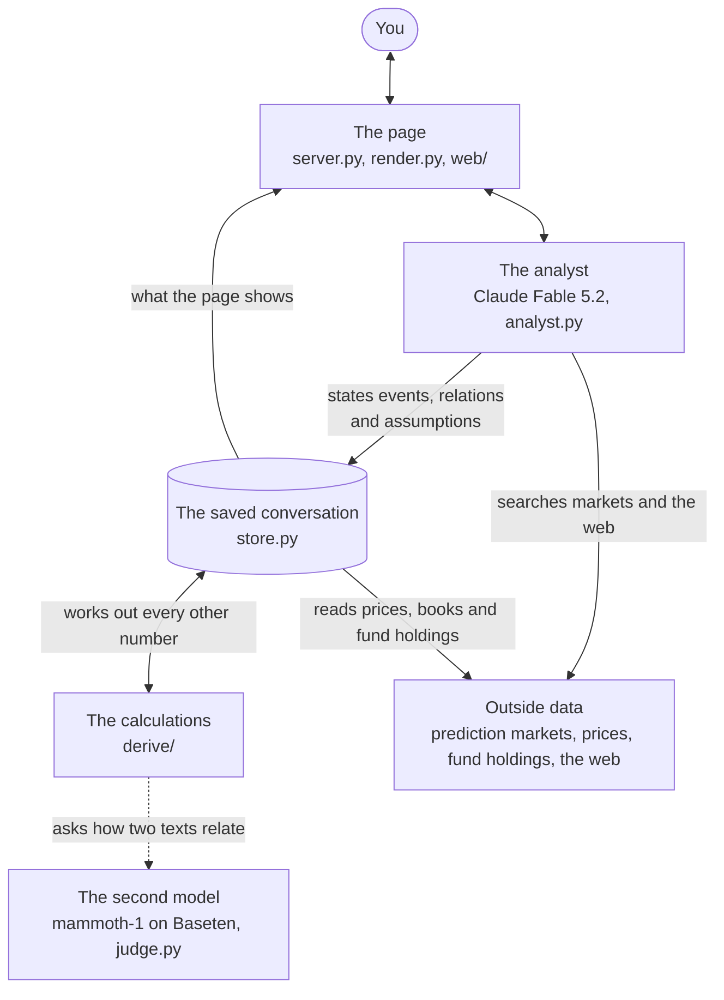

# event-risk

event-risk tells you what could move a portfolio. You give it your holdings and talk to an AI analyst (Claude Fable 5.2). The analyst finds the events that could move those holdings, in the world the businesses you own live in. It says how likely each is, using prediction markets where they bear on it, and shows what your portfolio gains or loses in each way an event can turn out.

Beside the conversation, the ledger lists each event with its figures. Every figure opens to what produced it: a market's book, a calculation, or an assumption the analyst stated, with its reasoning or the page it rests on.

| You ask | Where the answer comes from |
|---|---|
| What could move this portfolio? | The analyst, from what you own, the companies inside your funds included, from each company's news and filings, and from what is happening in their world |
| How likely is each event? | Prediction markets on Kalshi, Polymarket and Polymarket US. Markets rarely ask the event itself, so the analyst relates it to what they do ask: narrower claims, broader ones, and what it depends on. Code carries their prices to the event. Where no market bears on it, the analyst's estimate from the evidence it found |
| How much would it gain or lose? | What the analyst states each outcome does to prices, carried by code to everything you hold, and measured against what today's prices already carry |

**On this page**

- [Quickstart](#quickstart)
- [Use the page](#use-the-page)
- [Read an event](#read-an-event)
- [How it works](#how-it-works)
- [Tour the repository](#tour-the-repository)
- [Saved conversations](#saved-conversations)
- [Keys and limits](#keys-and-limits)
- [Run the tests](#run-the-tests)
- [Troubleshooting](#troubleshooting)

## Quickstart

### Set it up with a coding agent

Paste this into Claude Code, Codex, or the coding agent you use:

```
Clone https://github.com/owassmer/event-risk, install it with uv, put my Anthropic, Massive and Baseten keys in .env
(ask me for them), and start it with `uv run event-risk`. Follow the README if anything fails.
```

To set it up yourself, follow the steps below.

### Before you begin

You need:

- [uv](https://docs.astral.sh/uv/), which installs and runs the project. If your machine doesn't have Python 3.12 or later, uv fetches it.
- Three API keys. [Keys and limits](#keys-and-limits) says what each is for.
  - **Anthropic**, from the [Claude Console](https://platform.claude.com/). The account needs access to Claude Fable 5.2, which is the analyst, and Claude Haiku 5.5, which runs its web searches and reads the pages it opens.
  - **Baseten**, from [Baseten](https://www.baseten.co/), for the second model (mammoth-1, through Baseten's System One API). Without it the page still works, and new readings go unchecked.
  - **Massive**, from [Massive](https://massive.com/), for prices, what each fund holds, and companies' news and filings.

### Install

```
git clone https://github.com/owassmer/event-risk
cd event-risk
uv sync
```

### See a finished example

```
uv run example
```

The page opens on a finished conversation: a $919,000 brokerage account of seven stocks, five funds and cash, the ten events the analyst found for it, how likely each is, and what each would do, every figure one click from what produced it. You need no keys, and nothing is fetched. The example is read only. It opens a copy, so the shipped conversation stays as shipped.

### Add your keys

Create a file named `.env` at the top of the repository:

```
ANTHROPIC_API_KEY=...   # Claude: the analyst, its web search, and its reading of web pages
BASETEN_API_KEY=...     # Baseten: the second model
MASSIVE_API_KEY=...     # Massive: prices, what each fund holds, and companies' news and filings
```

Git ignores `.env`, so your keys stay on your machine.

### Start the page

```
uv run event-risk
```

The page opens in your browser at `http://127.0.0.1:8765/`, ready for a new conversation. `uv run example` uses the same address, so to run both at once give one of them another port: `--port 8777`.

### Open a saved conversation

Every conversation is saved in its own folder under `stores/`. To open one:

```
uv run event-risk --store stores/<name>
```

The page opens with that conversation and its events. You need no keys to read it.

## Use the page

The page opens on one question, **What could move your portfolio?**, with a box to answer it in.

Once your holdings are in, your portfolio appears on the left. Once the analyst adds its first event, the list of
events appears on the right, and the conversation sits between them.

```
┌────────────────┬────────────────────────────────┬────────────────────┐
│ Portfolio      │ The conversation               │ Events             │
│                │                                │                    │
│ total value    │ your messages                  │ one row per event, │
│ holdings       │ the analyst's replies          │ on one dollar axis │
│ weight         │ a line while it works          │                    │
│ factor         │                                │                    │
│ exposures      │ [ Message the analyst      ↑ ] │                    │
└────────────────┴────────────────────────────────┴────────────────────┘
```

Anything you open, such as an event, a holding, a factor or a market, takes the main area. The conversation stays
beside it, narrower, and the portfolio folds into a **Portfolio** button. On a narrow window, the side panels are
**Portfolio** and **Events** buttons at the top, and what you open covers the conversation. The page follows your
system's light or dark setting.

### 1. Give the analyst your holdings

Type or paste your holdings, one per line. Give each as dollars, a percentage or a number of shares, and include
cash. For example:

```
SPY 50%
AAPL 20%
TLT 20%
Cash 10%
$50,000 total. What could move this?
```

You can also drop in a broker statement (PDF), a spreadsheet export (CSV) or a screenshot, and the analyst reads it.

### 2. Watch your portfolio being priced

While your portfolio is priced, a line in the conversation names each stage: pricing your holdings, looking inside
your funds, reading two years of prices, and fitting your holdings' betas. The portfolio panel fills in as each part
is ready:

- **The total value,** its move today, and when the prices are from.
- **Horizon volatility:** how far the portfolio's value ordinarily moves over the period the events look ahead to.
- **Holdings,** as you gave them, each with its value, weight and day change.
- **Weight:** your largest companies once your funds are looked through, your largest industries, and your largest
  countries. A company you hold through a fund shows which fund.
- **Factor exposures:** your dollar beta to each factor, and that factor's largest month applied to it. A new
  portfolio starts with one factor, the S&P 500. The analyst adds a factor for each other force an event moves your
  portfolio through, such as rates, oil or a sector. A factor that is a yield shows the dollars your portfolio gains
  or loses for each percentage point it rises ("$/pp").

While the prices are today's, they and the prediction markets are read again every minute, and every figure on the
page updates with them. A holding you gave in dollars or as a weight keeps the number of shares it had then, so its
value moves with its price.

### 3. Watch the analyst work

The analyst reads your companies' news and filings and the pages it finds, decides which events matter to your
holdings, searches the prediction markets, and builds each event. While it works, one line names what it is doing
and counts its steps. Click the line to see its reasoning and each step, with what it sent and what came back.

Each event appears on the right as soon as the analyst adds it, and its figures fill in as they are worked out.

### 4. Open anything

You can click almost anything:

- an event, or any of its figures;
- a holding, a company, or a factor in your portfolio;
- a name in the analyst's reply. When the analyst mentions an event, a market, a company, a factor, a page it read,
  a shock, or a calculation, it shows as a small labelled box with its current figure.

What you open takes the main area. A figure opened from inside it, such as an event's **Calculation**, opens beside
it, with the event still in view. A breadcrumb trail runs across the top: **Back** goes back one step, and
**Events** returns to the list.

A holding opens like a broker's position page: its price over time, your position, what the company does or what
the fund holds, its betas, and the events that move it most. A factor opens to its proxy's price over two years with
its largest month marked, your dollar beta to it, and each holding's part of it. A market opens to its question, its
book, when it closes and what settles it.

### 5. Keep talking

- **Ask follow-up questions,** such as which event matters most for your largest holding. The analyst answers from
  what it has built.
- **Ask how events combine.** Each row is its event alone, so rows don't add. The analyst can read several events
  together and tell you what the portfolio does in each joint outcome.
- **Send a message while the analyst is working.** It waits, and goes when the reply ends.
- **Stop** ends the analyst's reply where it is. Everything it built so far stays.
- **Edit** one of your messages, or **Retry** one of the analyst's replies. The conversation goes back to just before
  that message, with everything the analyst built after it, and a new reply starts from there.

### 6. Save the results

Open the menu (⋯) at the top of the conversation:

- **Download ledger** saves a readable document with your portfolio and every event.
- **New portfolio** starts a new conversation.
- **Open conversation…** opens an earlier one.

## Read an event

The list on the right looks ahead to one date, which its header gives with the days to it. Each row is one event: its
title, then its **Forecast**, **Yes**, **No** and **Volatility** under the heads at the top. Under the forecast is
the **market-implied range**, and under Yes is that figure as a share of your portfolio. Where the midpoint of the
event's own market differs from the forecast, that market's book is on a line of its own.

Under each row is a bar on one dollar axis that every row shares, with **Today** at zero. It reaches from Today to
the event's farthest outcome on each side, losses in rust and gains in teal, with a tick at each outcome where the
event has more than two. The grey band behind it is your portfolio's horizon volatility, so each event's size reads
against how far the portfolio moves anyway. Sort the list by
**Volatility** or by **Worst outcome**.

Click an event to open it. Its header says when it can happen and how it would be known, with its **Definition** and
the analyst's **Rationale** a click away. Below the header is one strip of figures:

| Figure | What it is |
|---|---|
| **Forecast** | How likely the event is. **Calculation** under it opens how it is worked out. |
| **Market-implied range** | The lowest and highest the forecast can be, given the bids and asks of the markets whose prices the analyst uses and how it relates them to the event, before any probability the analyst states. |
| **Market** | The event's own market, where its midpoint differs from the forecast: its bid and ask in cents, as quoted, with its midpoint. |
| **Yes** | Your portfolio's gain or loss if the event happens: the part today's prices don't already carry. Under it, that as a share of your portfolio. |
| **No** | Your portfolio's gain or loss if it doesn't. |
| **Full impact** | Yes less No: what the event happening is worth against its not happening. |
| **Volatility** | The spread of your portfolio's gain or loss across the event's outcomes, each at its probability. |
| **Worst outcome** | The outcome with the lowest gain or loss, where the analyst has split the event into ways it can turn out. |
| **Expected value** | The outcomes' gains and losses averaged at their probabilities, where it isn't zero. Today's prices are taken to carry each outcome at its probability, so it is zero unless the analyst says prices carry the event at another weight or a holding is valued by what it pays. |

Below the strip are three tabs.

**Outcomes** shows the event as what it does to your portfolio.

- **The picture:** your portfolio's gain or loss at the horizon's end, in today's dollars. Each outcome has a row
  with its probability: a shape centred on its gain or loss, as wide as your portfolio ordinarily varies within it.
  All the outcomes together, each weighted by how likely it is, are at the bottom, with Today at zero.
- **The grid:** one column for each outcome, under Yes or No. Ways the event can turn out stand under their side, and
  the **baseline** outcome is marked. Its rows give each outcome's probability, your gain or loss, and the 5th and
  95th percentiles at the horizon's end. Under **Holding P&L**, each holding's part of it.
- **Largest contributors:** the names that contribute most to the full impact, where you hold each, directly or
  through which funds, and each one's part of it.

Click an outcome in the picture or the grid to select it everywhere on the page.

**Probability** shows where the forecast comes from, on one scale.

- Each market the forecast rests on is one row, named by what it asks, with its venue, its book (**YES bid** and
  **ask**, in cents), its depth, and a dot at its **Midpoint**. A market whose price the analyst doesn't use says so.
- **Forecast** sits beneath them, with the market-implied range as a band.
- Below the scale, each **Conditional probability** the analyst states stands beside its whole condition, **Given**
  one thing or **Not** another, marked **Analyst input**. This is how a market on a related question reaches the
  event.
- Where the analyst's forecast follows a market, the two stand side by side, as stated and now.
- The forecast's history at each reply follows, with the markets beside it. Then the markets the analyst read and
  didn't use, each with its **Rationale**, and the searches it made.

**Assumptions** shows what each outcome does to prices.

- **Moves:** each price's move in each outcome against the baseline. A **Shock** is a move the analyst states, and
  opens to its source and the passages it quotes. A move written with "residual" under it was stated as that price's
  move beyond what the factors give it. A quieter figure **moves with the stated ones**, as that price ordinarily
  moves with them.
- **Scenario prices:** each price's level in each outcome beside today's.
- Where the analyst values a holding by what it pays in each outcome, such as a takeover target, its values, and the
  weight its price implies on the event.

Click any figure to see its **Calculation** beside the event: the formula with its values filled in, each input
labelled and opening a step further, to the cent. Prices and values are to the cent everywhere; what an event does is
in whole dollars.

## How it works

### The parts and how they fit



The system has four parts.

- **The analyst reasons, and the assumptions are its own.** It decides which events matter to what you hold and defines each one. It relates each event to what markets ask, says whether it takes a market's price, and states the probabilities and the price moves that nothing observes, each with its reasoning or its source. It works through a fixed set of actions (`harness/tools.py`).
- **A second model reads claims about texts.** Where the analyst says a market asks a question, or that one claim implies another, the second model reads the two texts and says how they relate. Where its reading differs, the analyst is told what differs. Nothing waits on it, and it supplies no number.
- **The calculations do the rest.** They read prices, what your funds hold and each market's book. From those and from what the analyst stated they work out your betas, each event's probability, and what every holding is worth in each outcome.
- **The saved conversation holds it all.** Each conversation is one database. The analyst states what it believes there, and every other number is worked out from it when it is read, and again whenever something it rests on changes. Each number keeps what produced it.

### How an event's numbers are worked out

1. **What you own.** The page looks inside each fund, so a company you hold directly and through funds counts once, with all of its dollars. A new portfolio starts with one factor, the market. The analyst adds a factor for each other force an event moves your portfolio through, such as rates, oil or a sector, and each holding's betas are fitted on two years of daily prices.

2. **An event and its outcomes.** An event is something that happens in the world. It has outcomes: it happens or it does not, and where the ways it can turn out would move your holdings differently, the analyst gives it those ways, each with its own probability and effect. One outcome is the baseline that the others are measured from.

3. **From markets to a probability.** A market asks one question, the one its rules define. The analyst relates the event to it: one implies the other, or the event has a stated chance given it. A market on a narrower claim sets a floor under the event's probability, and one on a broader claim sets a ceiling; together they give the market-implied range. Within it, the forecast follows from the conditional probabilities the analyst states, and moves as the markets move. Whether a market's price is the probability of what it asks is the analyst's judgment, market by market. Where no market bears on an event, the forecast is the analyst's estimate from the evidence it found.

4. **From an outcome to dollars.** For each outcome the analyst states what it does to prices: a shock to a factor, or to a company or a fund itself. A shock is the price's whole move against the baseline, or its residual, the further move from the value it would otherwise have there. Code moves the other factors as they ordinarily move with the stated ones, and values each holding in each outcome: a stock by its betas, a fund by what it holds, an option or a leveraged fund by its terms, a takeover target by what the deal pays.

5. **What is already priced in.** Today's prices sit among an event's outcomes at the weight they put on each, which is taken to be the forecast unless the analyst states another. So each outcome shows what your portfolio does beyond what is priced in: **Yes** and **No**, the two sides; **Full impact**, the gap between them; **Volatility**, the spread of the outcomes at their probabilities; and **Worst outcome**.

6. **The range within an outcome.** An outcome is a centre, and prices vary around it as they ordinarily do to the horizon's end. The page draws each outcome as that distribution, so the tail shows.

## Tour the repository

```
event-risk/
├── harness/                the system
│   ├── analyst.py          runs the analyst: Claude with its actions, streaming, Stop, edit and retry
│   ├── claude.py           the settings and the key every request to Claude uses
│   ├── tools.py            the actions the analyst can take
│   ├── schema.py           every kind of thing a saved conversation can hold, declared once
│   ├── store.py            the saved conversation's database: what the analyst stated, the data behind it,
│   │                       and the snapshots that edit and retry go back to
│   ├── derive/             the calculations behind every number: what you own and its look-through,
│   │                       the probabilities, each outcome, and the distribution at the horizon
│   ├── judge.py            the second model's readings
│   ├── world.py            searching the markets, the web and companies' records, and reading pages
│   ├── web.py              web search and page reading through the Claude API
│   ├── venues/             the prediction markets (Kalshi, Polymarket, Polymarket US) and every data source
│   ├── readings.py         reads prices and market books again every minute while the prices are today's
│   ├── sessions.py         each exchange's trading days and closing times
│   ├── observations.py     the machine's shared cache of what sources answered about closed periods
│   ├── touches.py          what each calculation read, so a number is worked out again only when that changes
│   ├── ledger.py           the ledger's rows, the portfolio as it is shown, and what cannot hold together
│   ├── record.py           each reply's forecasts as they stood, and each one's outcome once markets settle it
│   ├── settlements.py      which markets have settled, and how
│   ├── render.py           draws the page's panels, views and the downloaded ledger
│   ├── server.py           the web server behind the page, and the event-risk and example commands
│   ├── trace.py            the conversation's record: every message, step and result
│   └── credentials.py      keeps API keys out of everything that is saved
├── knowledge/              what the analyst reads before it starts
│   ├── system.md           what it is told
│   ├── MATH.md             how every number is computed
│   ├── ONTOLOGY.md         every thing it can state, and what is worked out from each
│   ├── TOOLS.md            every action, with what it returns
│   ├── DATA.md             how to search the markets, the web and a company's record
│   └── channels.yaml       the one factor every new conversation starts with, the market
├── web/                    the page in the browser: HTML, JavaScript, styles and fonts
├── tests/                  the test suite
├── example/                one finished conversation, which uv run example opens
└── stores/                 your saved conversations, one folder each, kept out of Git
```

To understand the system, read in this order:

1. `knowledge/MATH.md`: all of the mathematics.
2. `knowledge/ONTOLOGY.md`: what the analyst can state, and what is worked out from each statement.
3. `knowledge/system.md`: what the analyst is told.
4. `harness/tools.py`: every action the analyst can take.
5. `harness/derive/`: how each number is calculated.

## Saved conversations

Each conversation is saved in its own folder:

```
stores/<name>/
├── store.sqlite   the database: what the analyst stated, the data it used, and every number worked out from it
├── trace.jsonl    the conversation's record: every message, step and result, in order
└── files/         files dropped into the conversation
```

- A conversation is saved when you send your first message. Its folder is named for the date of its prices, such as `stores/2026-11-05`, with `-2`, `-3` and so on where that name is taken.
- A saved conversation keeps all of the data it used, so it opens and explains every number with no keys.
- With the Anthropic key, you can go on talking in a saved conversation you opened.
- Git ignores `stores/`, so your conversations stay on your machine.
- `observations/`, beside `stores/`, is one cache for the machine: what the data sources answered about periods that have closed, such as two years of daily prices. Every conversation shares it. Git ignores it, and deleting it costs only reading again.

## Keys and limits

| Key | What it's for | Without it |
|---|---|---|
| `ANTHROPIC_API_KEY` | The analyst, its web search, and its reading of web pages | The analyst can't reply. Saved conversations still open. |
| `BASETEN_API_KEY` | The second model, which reads the analyst's claims about what a market asks | New readings go unchecked. Every number is still worked out. |
| `MASSIVE_API_KEY` | Prices, what each fund holds, and companies' news and filings | A new portfolio can't be priced, and companies' news and records can't be read. Saved conversations still open. |

What a Massive account gives depends on its plan:

- **Stocks** gives prices, each company's reference data, the news that comes with a portfolio, and the text of SEC filings.
- **ETF Global** is a separate entitlement, and gives each fund's holdings daily. Without it, a fund is read from its latest holdings report at the SEC, which needs no key and is older. A fund that files none, such as a commodity pool or a coin trust, is held whole.
- **Benzinga** is a separate entitlement, and gives a company's newswire, results, guidance and analysts' ratings. Without it, the analyst is told those cannot be read; filings still can.
- **Options** is a separate entitlement, and gives the quotes of listed options. A portfolio that holds a fund with listed options, such as a covered-call or buffer fund, needs it to be priced.

These sources need no key: Coinbase Exchange for crypto prices; Yahoo Finance for listings outside the United States, currencies and mutual funds; OpenFIGI and the SEC for identifying what funds hold; and the Treasury, the European Central Bank, the Federal Reserve, the Bank for International Settlements, Japan's Ministry of Finance and the Bank of Canada for yields and exchange-rate fixings. OpenFIGI answers faster with a free key of its own, `OPENFIGI_API_KEY`, where you set one.

A missing key shows as one line, only where it stops something. Without the Anthropic key, the message box says the analyst can't reply. Without the Baseten or Massive key, a line in the message box says what goes without it.

What to expect:

- **The first portfolio on a machine takes the longest to price,** because it reads two years of prices for everything you hold, directly and through funds. Later ones reuse what was read.
- **The analyst's first answer is a whole analysis and usually takes twenty to thirty minutes.** It reads the news and your companies' records, searches the markets, and builds each event, in around two hundred steps. You can watch each step, and events appear in the ledger as they are built.
- **The ledger looks over 180 days** unless you ask for another horizon.

## Run the tests

```
uv run pytest -q
```

The tests need no keys and no network. Every outside source is replaced with a stand-in: the markets, the price and holdings data, the web search and the second model.

## Troubleshooting

- **A line in the message box names a missing key.** Add the key to `.env` and start the page again.
- **The analyst can't search the web.** An administrator can turn web search off for an organization in the Claude Console. Turn it back on there.
- **"The analyst couldn't reply" appears.** The line gives the reason, such as an account's usage limit. Send your message again once the cause is fixed.
- **The port is already in use.** Start on another: `uv run event-risk --port 8777`.
- **You want to start the page without opening a browser.** Run `uv run event-risk --no-browser`.

## Learn more

`knowledge/` holds everything the analyst reads, and it is also the most exact description of the system:

- `MATH.md`: the mathematics;
- `ONTOLOGY.md`: what the analyst can state, and what is worked out from each statement;
- `TOOLS.md`: every action the analyst can take, with what it returns;
- `DATA.md`: how the analyst searches the prediction markets, the web and a company's record;
- `system.md`: what the analyst is told.
